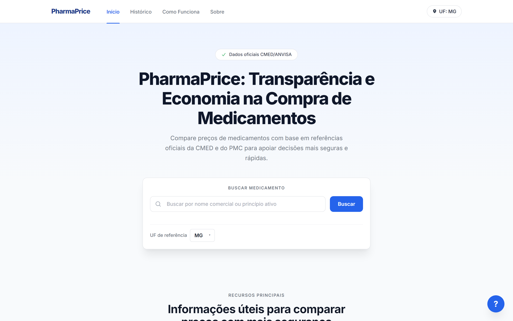
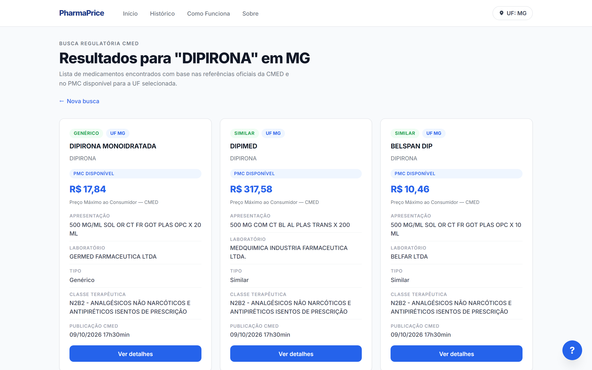
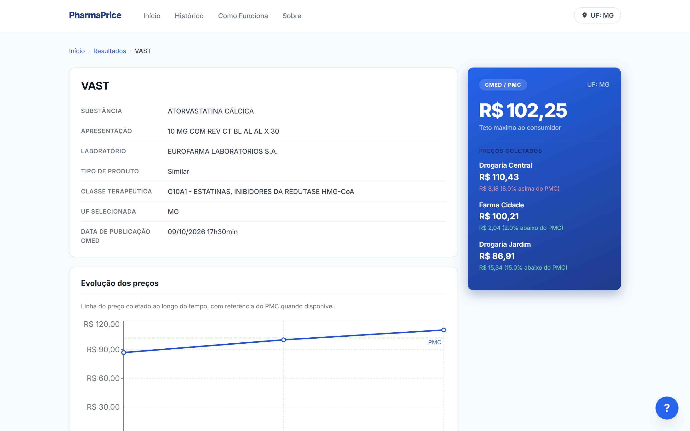
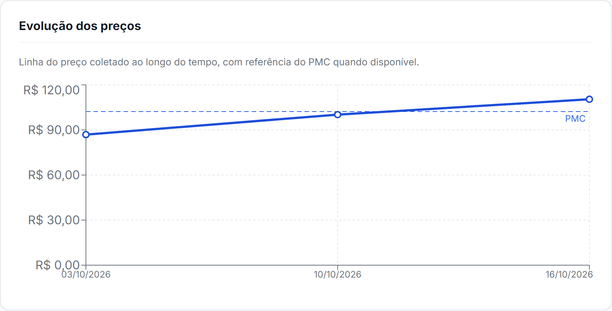
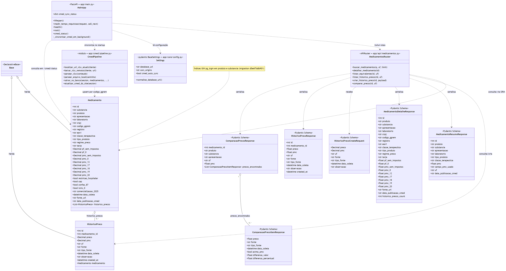

# PharmaPrice 💊

**Sistema web para comparação de preços de medicamentos com integração de dados regulatórios da CMED/ANVISA**

Trabalho de Conclusão de Curso II (TCC2) — Bacharelado em Sistemas de Informação
Instituto Federal de Educação, Ciência e Tecnologia do Sudeste de Minas Gerais — Campus Juiz de Fora (IF Sudeste MG)

**Autor:** Bernardo Oliveira Duarte
**Orientador:** Prof. Emerson Augusto Priamo Moraes
**Ano:** 2026

**Aplicação publicada:** https://pharmaprice.vercel.app/

---

## Sobre o projeto

O PharmaPrice é um sistema web responsivo que integra dados regulatórios da CMED (Câmara de Regulação do Mercado de Medicamentos/ANVISA) com preços de medicamentos, permitindo ao consumidor comparar o preço encontrado com o Preço Máximo ao Consumidor (PMC) definido pelo governo.

O principal diferencial do sistema é tornar visível o teto regulatório da CMED no momento da decisão de compra — algo que plataformas comerciais existentes como Consulta Remédios e CliqueFarma não fazem explicitamente.

Este repositório contém a **implementação do protótipo funcional** desenvolvida no TCC2. O modelo conceitual completo foi apresentado, aceito e publicado nos anais do XII Congresso Internacional em Tecnologia e Organização da Informação (TOI 2026), disponíveis nos links da seção [Publicações](#publicações).

> **Aviso:** os preços coletados exibidos nas telas de detalhes e no gráfico de evolução são **dados fictícios de demonstração**, inseridos por script. O PMC, por outro lado, vem da planilha oficial da CMED.

---

## Telas

As capturas abaixo estão em [`docs/screenshots/`](docs/screenshots/).

| Home | Resultados da busca |
| :---: | :---: |
|  |  |

| Detalhes do medicamento (PMC × preços coletados) | Evolução dos preços |
| :---: | :---: |
|  |  |

---

## Stack tecnológica

| Camada          | Tecnologia                | Versão                          |
| --------------- | ------------------------- | ------------------------------- |
| Backend         | Python + FastAPI          | 3.12 / 0.115                    |
| Banco de dados  | PostgreSQL + pg_trgm      | 16                              |
| ORM             | SQLAlchemy + Alembic      | 2.0 / 1.13                      |
| Leitura da CMED | openpyxl + httpx          | 3.1 / 0.27                      |
| Frontend        | React + Vite + TypeScript | 19 / 8 / 6.0                    |
| Visualização    | Recharts                  | 3.9                             |
| Testes          | pytest + pytest-cov       | 8.3 / 5.0                       |
| Containerização | Docker + Docker Compose   | PostgreSQL local                |
| Implantação     | Vercel (frontend) e Render (API + banco) | —                |

---

## Estrutura do repositório

```
pharmaprice/
├── backend/
│   ├── app/
│   │   ├── api/            # Endpoints REST (busca, detalhe, histórico, comparação, equivalentes)
│   │   ├── core/           # Configurações e variáveis de ambiente
│   │   ├── db/             # Modelos SQLAlchemy e sessão
│   │   ├── cmed/           # Pipeline de importação da tabela CMED/ANVISA
│   │   └── scripts/        # Scripts auxiliares (seed de dados demonstrativos)
│   ├── alembic/            # Migrations do banco de dados
│   ├── tests/              # Testes automatizados (pytest)
│   ├── .env.example
│   └── requirements.txt
├── frontend/
│   ├── src/
│   │   ├── components/     # ResultadoCard, PmcPricingCard, GraficoHistoricoPrecos,
│   │   │                   # BuscaProgresso, EquivalentesSection, Assistente, etc.
│   │   ├── pages/          # HomePage, ResultadosPage, DetalhesPage, HistoricoPage,
│   │   │                   # ConfiguracoesPage, ComoFuncionaPage, SobrePage
│   │   └── services/       # api.ts, historico.ts, configuracoes.ts
│   ├── .env.example
│   └── package.json
├── docs/
│   ├── apresentacao_tcc_ii/  # Apresentação final do TCC II (.pptx)
│   ├── artigo_sbc/           # Artigo do TCC no formato SBC (.pdf)
│   ├── screenshots/          # Capturas de tela da aplicação
│   ├── pharmaprice_uml_classes.png
│   └── pharmaprice_uml_classes.mmd
├── dados/                  # Planilha local da CMED (opcional, para importação manual)
├── docker-compose.yml      # PostgreSQL local para desenvolvimento
├── render.yaml             # Configuração de implantação da API e do banco no Render
├── env.example
└── README.md
```

---

## Diagrama de Classes

Diagrama de classes UML do backend (modelos SQLAlchemy, schemas Pydantic da API e rotas), gerado com [Mermaid](https://mermaid.js.org) a partir do código-fonte do repositório. O arquivo-fonte editável está em [`docs/pharmaprice_uml_classes.mmd`](docs/pharmaprice_uml_classes.mmd).



---

## Como rodar localmente

### Pré-requisitos

- Python 3.12+
- Node.js 20+
- Docker e Docker Compose

### 1. Subir o banco de dados

Na raiz do projeto:

```bash
docker compose up -d db
```

O banco sobe na porta `5434` (configurável em `docker-compose.yml`), com usuário, senha e banco `pharmaprice`.

### 2. Backend

```bash
cd backend
python -m venv venv
source venv/bin/activate        # Linux/macOS
# venv\Scripts\activate         # Windows

pip install -r requirements.txt
alembic upgrade head
uvicorn app.main:app --reload
```

- API: http://localhost:8000
- Swagger: http://localhost:8000/docs
- Variáveis de ambiente: copie `backend/.env.example` para `backend/.env` e ajuste, se necessário.

**Importação dos dados da CMED.** Por padrão (`CMED_AUTO_SYNC=true`), o backend baixa a planilha mais recente do site da CMED e sincroniza o banco em segundo plano a cada inicialização, sem bloquear a API. O andamento pode ser consultado em `GET /cmed/status`. A primeira sincronização leva alguns minutos, e a busca só retorna resultados depois que ela termina.

Para importar manualmente a partir de um arquivo local (com `CMED_AUTO_SYNC=false`, por exemplo):

```bash
python -m app.cmed.importar "caminho/para/cmed.xlsx"
```

> A planilha pode ser baixada diretamente da ANVISA: https://www.gov.br/anvisa/pt-br/assuntos/medicamentos/cmed/precos
> O arquivo não é versionado no repositório (`.gitignore`). O pipeline reconhece o layout antigo (aba única) e o atual (abas `Cabeçalho` e `Lista PMC`).

### 3. Frontend

```bash
cd frontend
npm install
npm run dev
```

App disponível em: http://localhost:5173

Para alterar a URL da API (ex.: produção), crie `frontend/.env`:

```bash
VITE_API_URL=http://127.0.0.1:8000
```

### 4. Dados demonstrativos (histórico de preços)

Para popular a tabela de histórico com preços fictícios de demonstração (necessário para ver a comparação com o PMC e o gráfico de evolução):

```bash
cd backend
python -m app.scripts.seed_historico_precos
```

O script é idempotente: não duplica registros se for executado novamente.

### 5. Testes e qualidade

```bash
cd backend
pytest --cov=app tests/ --cov-report=term-missing

cd ../frontend
npm run lint
npm run build
```

---

## Implantação

| Parte    | Plataforma | Observações |
| -------- | ---------- | ----------- |
| Frontend | Vercel     | `frontend/vercel.json` reescreve todas as rotas para o `index.html` (SPA). |
| API e banco | Render  | Definidos em `render.yaml`. O start executa `alembic upgrade head` antes do Uvicorn. |

No plano gratuito do Render, a API hiberna após cerca de 15 minutos sem requisições, e a primeira busca depois disso pode levar cerca de 40 segundos. Por isso o frontend chama `GET /health` ao carregar e exibe uma barra de progresso com as etapas da busca, e um monitor externo pode chamar o mesmo endpoint periodicamente para manter o serviço acordado.

---

## Endpoints da API

| Método | Rota | Descrição |
|--------|------|-----------|
| `GET` | `/health` | Verificação leve de disponibilidade (sem acesso ao banco) |
| `GET` | `/cmed/status` | Data de publicação da CMED e estado da sincronização automática |
| `GET` | `/medicamentos/?q=&uf=` | Busca fuzzy por nome ou princípio ativo, com PMC por UF |
| `GET` | `/medicamentos/{id}` | Detalhe completo do medicamento |
| `GET` | `/medicamentos/{id}/historico-precos?uf=` | Histórico de preços coletados |
| `POST` | `/medicamentos/{id}/historico-precos` | Inserção de novo registro de preço |
| `GET` | `/medicamentos/{id}/comparacao-precos?uf=` | Comparação entre preço coletado e PMC |
| `GET` | `/medicamentos/{id}/equivalentes?uf=` | Medicamentos com a mesma substância ativa |

Todas as respostas incluem o cabeçalho `Server-Timing` com o tempo de processamento, e as requisições são registradas em log com sua duração.

---

## Escopo do protótipo (TCC2)

### Implementado

- [x] Pipeline de importação e normalização da tabela CMED/ANVISA, manual e automático, compatível com os dois layouts da planilha
- [x] Busca de medicamento por nome comercial ou princípio ativo (busca fuzzy com pg_trgm e índices GIN)
- [x] PMC dinâmico por UF — todas as 27 unidades federativas
- [x] Histórico de preços por medicamento e UF com dados demonstrativos
- [x] Comparação explícita entre preço coletado e PMC (valor e percentual)
- [x] Equivalentes: medicamentos com a mesma substância ativa (genérico, similar, referência)
- [x] API REST documentada (FastAPI + Swagger automático), com `/health` e medição de tempo das requisições
- [x] Frontend — fluxo principal: Home → Resultados → Detalhes
- [x] Frontend — telas complementares: Histórico, Configurações, Como Funciona, Sobre
- [x] Indicador de carregamento da busca, com barra de progresso e etapas
- [x] Título da aba por página (`PharmaPrice - {página}`) e novo ícone
- [x] Gráfico de evolução de preços com linha de referência no PMC (Recharts)
- [x] Assistente FAQ com respostas pré-definidas sobre o sistema e regulação de preços (sem IA)
- [x] Histórico local de buscas e visitas (localStorage, conforme princípios da LGPD)
- [x] Chips de buscas recentes na Home
- [x] Configurações de usuário com persistência local (UF, raio, preferências de tipo)
- [x] Design responsivo baseado em protótipo Figma
- [x] Testes automatizados do backend: 39 testes, 73% de cobertura na versão atual (71% na versão medida no artigo)
- [x] Variável de ambiente para URL da API (`VITE_API_URL`)
- [x] Implantação em produção (Vercel + Render)

### Pendente / Trabalhos futuros

- [ ] Scraping automatizado de farmácias (Drogasil, Ultrafarma, Droga Raia e outras)
- [ ] Recomendação com explicabilidade (IA)
- [ ] Login e cadastro de usuário com sincronização de histórico e preferências
- [ ] Geolocalização com raio de busca configurável por GPS ou CEP
- [ ] Mapeamento de convênios de desconto por farmácia
- [ ] Monitoramento de preços com alertas ao usuário
- [ ] Equivalência considerando concentração e apresentação
- [ ] Testes automatizados do frontend e da sincronização automática
- [ ] Validação empírica com usuários reais (usabilidade e acurácia)

---

## Publicações

### Anais do TOI 2026

O modelo conceitual do PharmaPrice (TCC I) foi publicado nos anais do **XII Congresso Internacional em Tecnologia e Organização da Informação (TOI 2026)**:

- Página do trabalho nos anais: https://doity.com.br/anais/toi2026/trabalho/521740
- Registro no Zenodo: https://zenodo.org/records/23099458 (DOI: [10.5281/zenodo.23099458](https://doi.org/10.5281/zenodo.23099458))

> DUARTE, B. O.; MORAES, E. A. P. PharmaPrice: Sistema Web Inteligente para Comparação de Preços de Medicamentos com Integração de Dados Regulatórios da CMED. In: **Anais do XII Congresso Internacional em Tecnologia e Organização da Informação (TOI 2026)**, Guimarães, Portugal, 2026. ISSN 2965-4130. https://doi.org/10.5281/zenodo.23099458

### Artigo do TCC (formato SBC)

O relato completo do trabalho, do modelo conceitual do TCC I ao protótipo do TCC II, está no artigo [`docs/artigo_sbc/PharmaPrice_Artigo_SBC.pdf`](docs/artigo_sbc/PharmaPrice_Artigo_SBC.pdf):

> DUARTE, B. O.; MORAES, E. A. P. PharmaPrice: Modelo Conceitual e Implementação de um Sistema Web para Comparação de Preços de Medicamentos com Dados da CMED.

A apresentação final do TCC II está em [`docs/apresentacao_tcc_ii/`](docs/apresentacao_tcc_ii/).

---

## Licença

MIT License — veja [LICENSE](./LICENSE) para detalhes.
